<p align="center">
  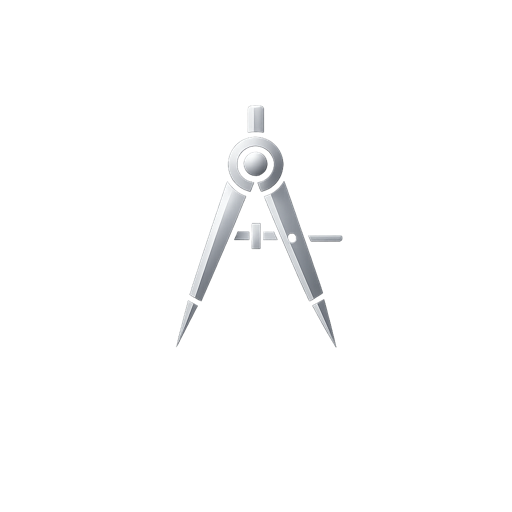
</p>

<h1 align="center">Architect</h1>

<p align="center">
  <strong>Design specs for AI agents.</strong><br />
  An open-source spec authoring studio that turns scattered ideas into the structured project documentation Claude Code, Cursor, Aider, and other AI coding agents need before they can ship code.
</p>

<p align="center">
  <em>A Hesper Labs product.</em>
</p>

<p align="center">
  <a href="LICENSE"></a>
  
  
  
  
</p>

<p align="center">
  <a href="#features">Features</a> ·
  <a href="#quick-start">Quick start</a> ·
  <a href="#using-claude">Using Claude</a> ·
  <a href="#deploy-your-own">Deploy</a> ·
  <a href="docs/README.md">Documentation</a> ·
  <a href="ARCHITECTURE.md">Architecture</a>
</p>

---

<p align="center">
  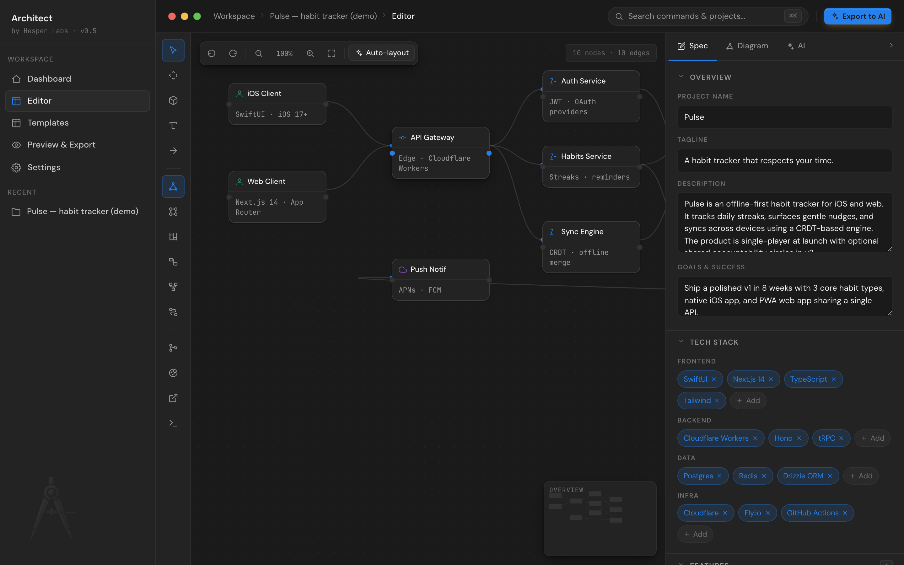
</p>

## Why Architect?

AI coding agents are dramatically more useful when given clean, structured project specs — features, data models, API endpoints, user stories, architecture diagrams, decision records — instead of a vague prompt.

Architect helps you **author** that spec visually, validate it, and ship it to your AI agent of choice. Local-first, BYOK, no servers, no telemetry.

| Without Architect                                                 | With Architect                                                            |
| ----------------------------------------------------------------- | ------------------------------------------------------------------------- |
| Paste a vague description into Claude → hope for the best         | Author a structured spec, validate gaps, push as `CLAUDE.md` to your repo |
| Re-explain context every conversation                             | One canonical artifact every agent reads from                             |
| Forget the architecture decisions you made last week              | ADR + Risk register kept alongside the spec                               |
| Diagrams in Notion, models in Linear, decisions in a Slack thread | All in one app, exportable as Markdown / JSON / Mermaid                   |

## Features

### Spec editor + architecture canvas


Left: tool rail with the diagram canvas tools, diagram-type switcher, and modal launchers (history, design tokens, handoff, Claude Code chat). Center: the architecture canvas with drag-and-drop nodes, six diagram types (system / flow / sequence / ER / state / tree), free-form sticky notes, and click-to-connect edges. Right: collapsible spec panel with three tabs — **Spec** for the structured form, **Diagram** for node properties, **AI** for inline Claude review.

### First-run welcome wizard

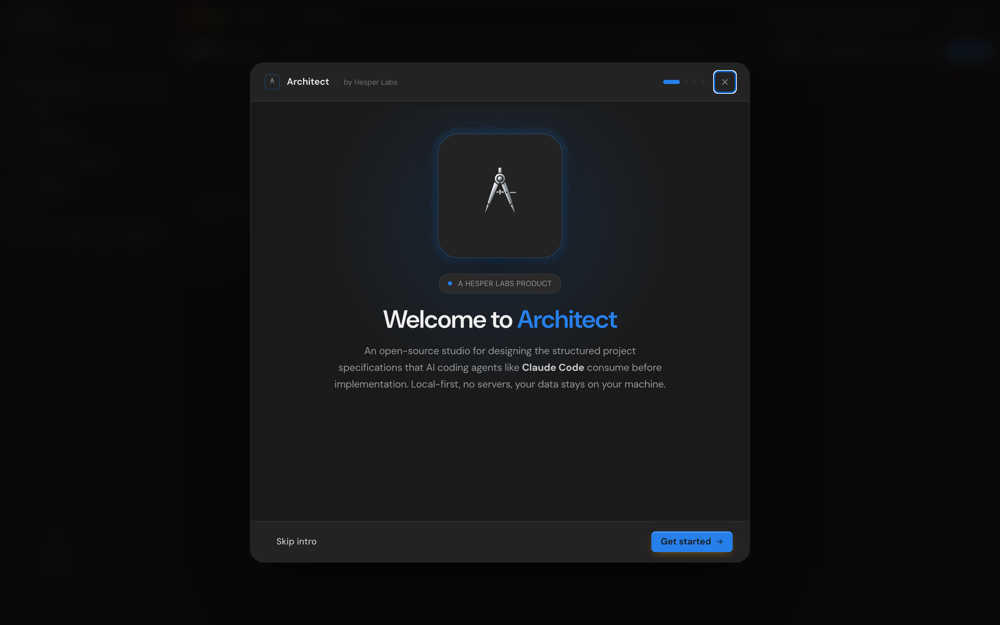
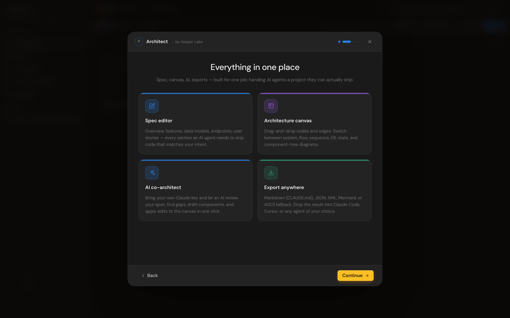

Four-step intro for new users: hero / feature tour / BYOK Claude key setup / "let's create your first project" CTA. Shows once, never again — first-run state lives in `localStorage`.

### New project wizard

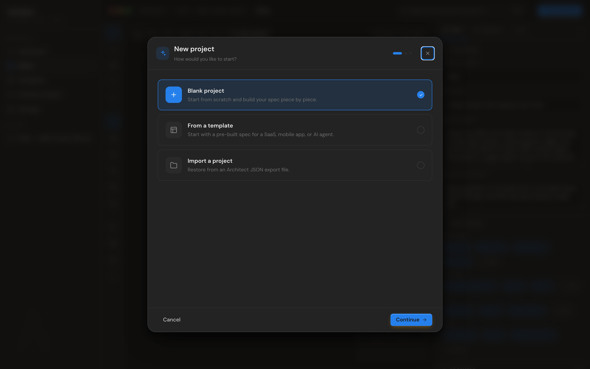

Three flows: **Blank** (with architecture preset — monolith / microservices / serverless / mobile-first / AI agent), **From template** (six bundled spec templates), **Import** (`.architect.json` file you exported earlier). Auto-suggests project name and tagline from the chosen preset.

### Project dashboard

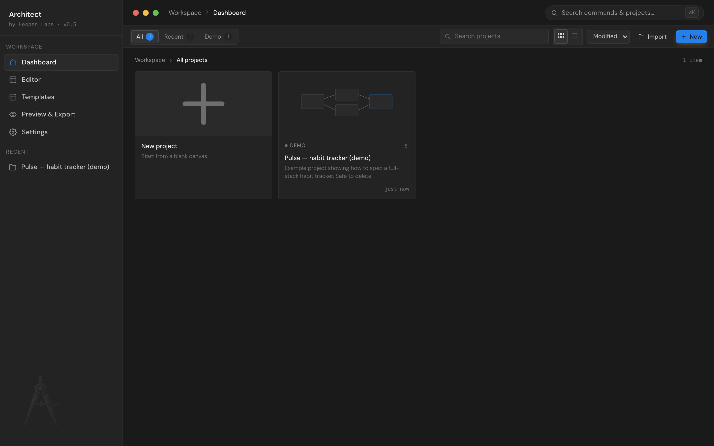

Grid or list view, search, sort by modified / name / created, tabs for All / Recent / Demo, per-project menu (rename / export / delete), inline JSON import / export. Pulse demo project loads on first run; safe to delete once you find your footing.

### Handoff package — ADR + Risk register

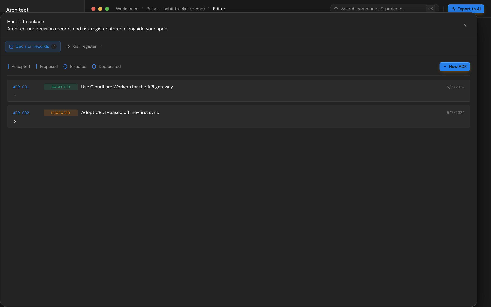

Architecture Decision Records (status, context, decision, consequences, alternatives, deciders) and a Risk Register (likelihood × impact severity, owner, mitigation, status) — both editable, both stored alongside the spec, both flow into the Markdown export.

### Export anywhere

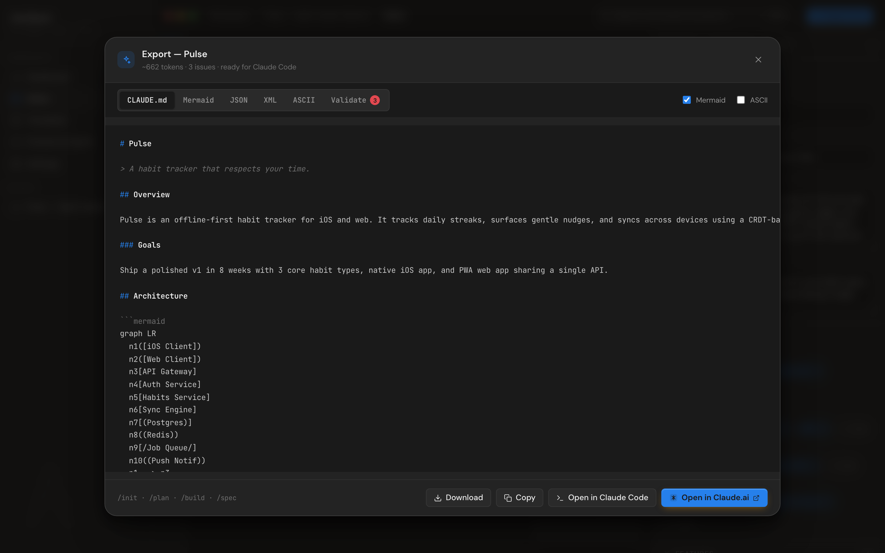

Five tabs: **CLAUDE.md** (Markdown for Claude Code), **Mermaid** (for any agent or doc that renders Mermaid), **JSON** (machine-readable), **XML** (for agents that prefer it), **ASCII** (text fallback for environments without Mermaid), **Validate** (score + issues with concrete fixes).

Five output paths from the export modal:

- **Download** — save as `CLAUDE.md`, `.mmd`, `.json`, `.xml`, or `.txt`
- **Copy** — clipboard
- **Open in Claude Code** — downloads `CLAUDE.md` and copies a `cat > CLAUDE.md … claude` shell snippet to start a Claude Code session
- **Open in Claude.ai** — copies the spec and opens a fresh `claude.ai/new` chat in a new tab
- **Push to GitHub** — real PAT-based REST flow that creates a feature branch, commits `CLAUDE.md`, and (optionally) opens a PR against your default branch

### AI co-architect (BYOK)

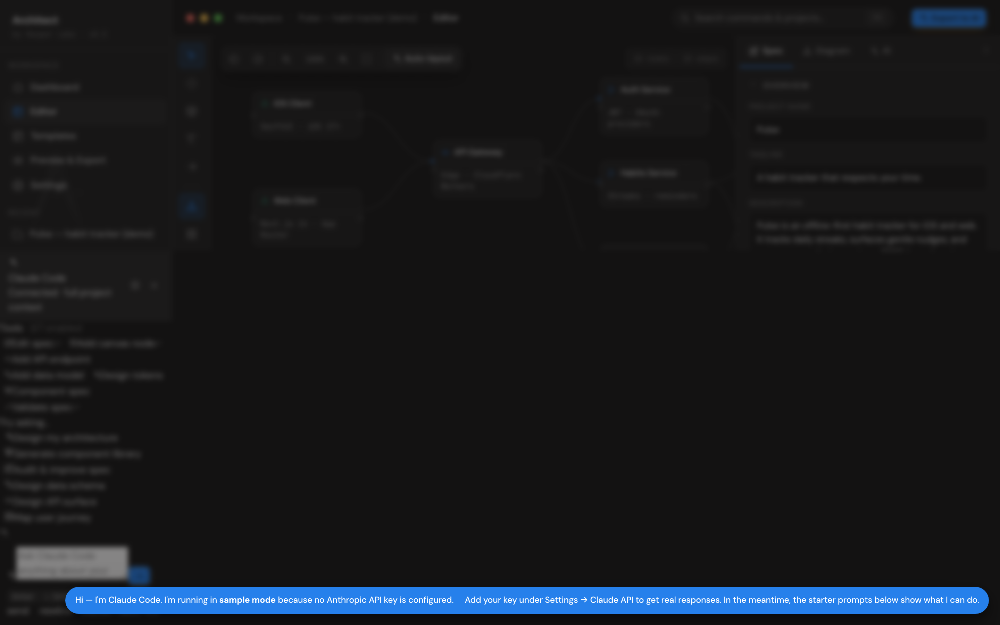

Full-context drawer that knows your spec, canvas, and diagram type. Suggests architecture, drafts components, validates designs. Apply suggestions to the canvas with one click via inline `[TOOL]` blocks. Falls back to canned sample responses when no API key is configured — the panels never look broken.

### Command palette

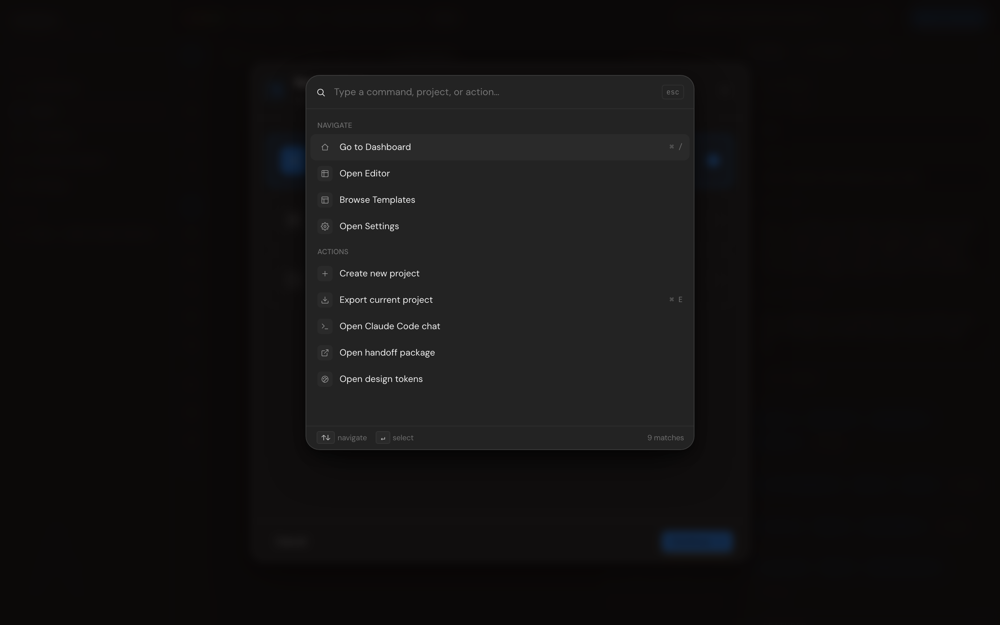

`⌘K` (or `Ctrl K`) anywhere — fuzzy search across navigate / actions / recent projects. Keyboard-only flow: arrow keys, Enter, Escape.

### Settings — every integration in one place

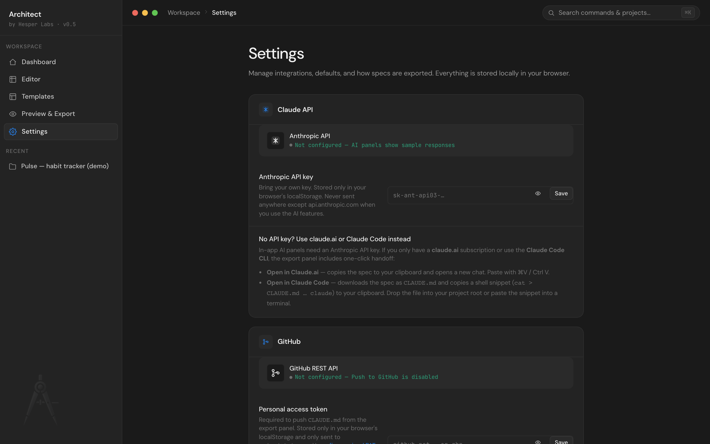

BYOK Anthropic API key, GitHub PAT, export defaults, theme. Nothing leaves your browser except a key going to `api.anthropic.com` or `api.github.com` when you explicitly use those features.

### Light theme


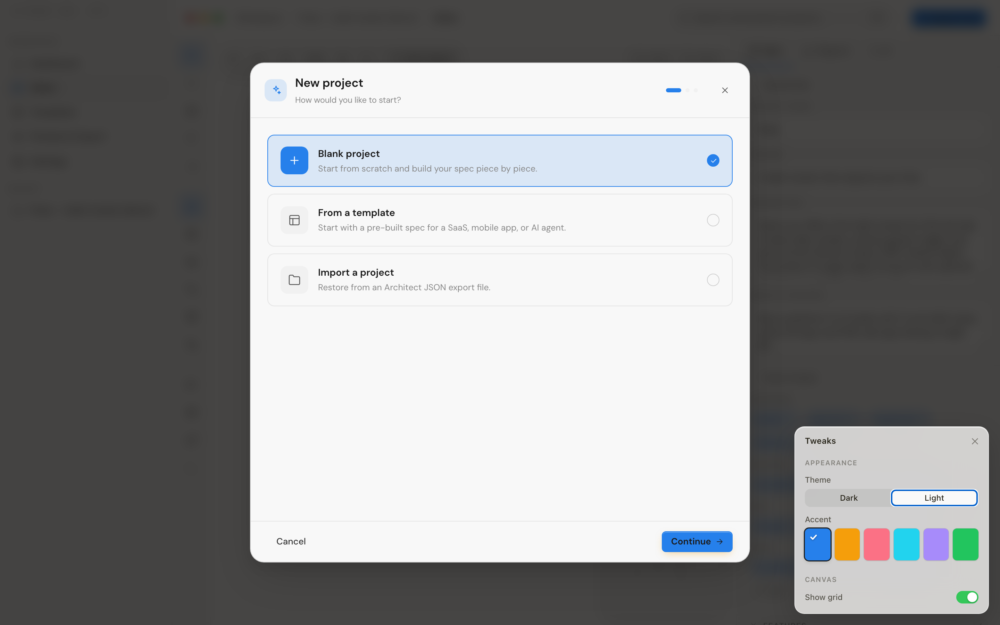

Toggle from the Tweaks panel (bottom-right). Persisted, applies app-wide.

## Quick start

```bash
git clone https://github.com/Hesper-Labs/architect.git
cd architect
npm install
npm run dev
```

Open the URL Vite prints (typically `http://localhost:5173`). The Welcome wizard will guide you through your first project.

### Available scripts

| Command               | What it does                                                                  |
| --------------------- | ----------------------------------------------------------------------------- |
| `npm run dev`         | Vite dev server with hot-module reload                                        |
| `npm run build`       | Production bundle in `dist/`                                                  |
| `npm run preview`     | Serve the production build locally                                            |
| `npm test`            | Run the 95-test Vitest suite                                                  |
| `npm run lint`        | ESLint check                                                                  |
| `npm run format`      | Prettier format                                                               |
| `npm run check`       | Run lint + format check + test + build (one-shot)                             |
| `npm run screenshots` | Regenerate `docs/screenshots/*.png` via Playwright (needs dev server running) |

## Using Claude

Architect supports three handoff paths to Claude — pick whichever your account has:

| You have                   | Path                              | What happens                                                                                                                                                |
| -------------------------- | --------------------------------- | ----------------------------------------------------------------------------------------------------------------------------------------------------------- |
| **Anthropic API key**      | Settings → Claude API → paste key | In-app AI panels (chat, audit, suggestions) call `api.anthropic.com` directly with your key                                                                 |
| **claude.ai subscription** | Export → **Open in Claude.ai**    | Spec is copied to clipboard, a new `claude.ai/new` chat opens — paste with ⌘V                                                                               |
| **Claude Code CLI**        | Export → **Open in Claude Code**  | `CLAUDE.md` is downloaded and a shell snippet is copied to your clipboard — paste in your terminal or drop the file into your project root and run `claude` |

The Anthropic API key is stored only in `localStorage` and only sent to `api.anthropic.com`. See [docs/byok-claude.md](docs/byok-claude.md) for details and [SECURITY.md](SECURITY.md) for the threat model.

## Push to GitHub


Settings → GitHub → paste a [fine-grained PAT](https://github.com/settings/tokens?type=beta) with `Contents: read+write` and `Pull requests: read+write`. From the Export modal, hit **Push to GitHub**: Architect resolves the default branch, creates a feature branch, commits `CLAUDE.md`, and opens a PR. Real REST calls, no proxy. See [docs/github-push.md](docs/github-push.md).

## Deploy your own

Architect is a static site — fork it and host anywhere:

| Host             | How                                                                        |
| ---------------- | -------------------------------------------------------------------------- |
| **Vercel**       | [Import the repo](https://vercel.com/new) → it auto-detects Vite and ships |
| **Netlify**      | [Connect the repo](https://app.netlify.com/start) — works out of the box   |
| **GitHub Pages** | `npm run build` then serve `dist/` from the `gh-pages` branch              |
| **Self-hosted**  | Any static file server (Caddy / Nginx / S3+CloudFront / Cloudflare R2)     |

The `vercel.json` at the repo root preconfigures SPA rewrites and immutable asset caching.

## Tech

- **React 18** + **Vite 5**
- **Zustand** for state, `StorageAdapter` for swappable persistence
- **JSDoc** for type hints (no TypeScript build step)
- **Vitest** + jsdom + `@testing-library/react` for the 95-test suite
- **Playwright** for automated screenshots
- **ESLint** flat config + **Prettier** + **Husky** + **lint-staged**
- **GitHub Actions** CI matrix on Node 20 + 22
- **Dependabot** weekly
- ~75 KB of hand-crafted CSS, no UI framework

See [ARCHITECTURE.md](ARCHITECTURE.md) for the codebase walkthrough and [docs/](docs/README.md) for end-user documentation.

## Browser support

Modern evergreen browsers released in the last ~18 months:

| Browser        | Minimum |
| -------------- | ------- |
| Chrome / Edge  | 110+    |
| Safari         | 16+     |
| Firefox        | 110+    |
| iOS Safari     | 16+     |
| Chrome Android | 110+    |

The build targets ES2020 and uses `color-mix()`, `:has()`, and `backdrop-filter`. Older browsers may degrade gracefully but aren't supported.

## What's intentionally out of scope

Architect is **local-first by design**. The following won't ship without forking and adding a backend:

- Multi-user real-time collaboration
- SSO / SAML / SCIM
- Audit logs
- Role-based permissions
- Hosted SLA

The `StorageAdapter` interface in [src/lib/storage/](src/lib/storage/) is built so a fork can drop in Supabase, Postgres, IndexedDB, or a custom HTTP backend without touching anything else. See [docs/extending.md](docs/extending.md).

## Contributing

PRs welcome — see [CONTRIBUTING.md](CONTRIBUTING.md). By participating you agree to the [Code of Conduct](CODE_OF_CONDUCT.md). Security issues go through the [private disclosure process](SECURITY.md).

## License

MIT — see [LICENSE](LICENSE).

---

<p align="center">
  Built with care by <strong>Hesper Labs</strong> and the open-source community.
</p>
