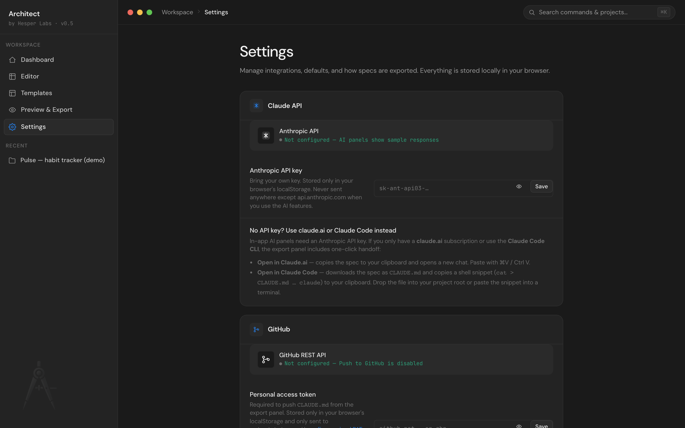
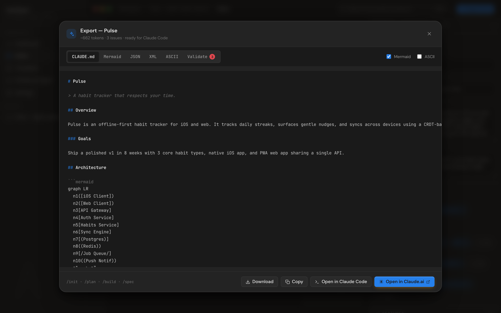

# BYOK Claude — three paths

Architect's AI features are powered by Claude. Three different ways to wire it up depending on what kind of Anthropic account you have.

| You have                           | Where to start                   | What happens                         |
| ---------------------------------- | -------------------------------- | ------------------------------------ |
| **Anthropic API key** (`sk-ant-…`) | Settings → Claude API            | In-app AI panels work directly       |
| **claude.ai subscription**         | Export → **Open in Claude.ai**   | Spec → clipboard → new chat          |
| **Claude Code CLI**                | Export → **Open in Claude Code** | `CLAUDE.md` download + shell snippet |

You can use any combination. Most people end up using API + claude.ai together: API for in-editor audits, claude.ai for longer brainstorm sessions.

## Path 1 — Anthropic API key



1. Get a key at [console.anthropic.com](https://console.anthropic.com/)
2. Open Settings → Claude API
3. Paste the key, hit **Save**
4. Status pill flips to "Connected"

Once configured:

- The in-app **AI** tab in the spec panel (`<AIAssistant />`) sends your prompts directly to `api.anthropic.com`
- The **Claude Code chat** drawer (tool rail → Chat) does the same with full project context + `[TOOL]` block apply-to-canvas actions

Your key:

- Stored only in `localStorage` at the key `architect:claude_api_key`
- Sent only to `api.anthropic.com` (allowed by the strict CSP in `index.html`)
- Never sent anywhere else, ever
- Hidden by default in Settings (eye icon to reveal)

The Anthropic API requires the `anthropic-dangerous-direct-browser-access: true` header, which Architect sets automatically. This is acceptable for self-hosted, single-user deployments — see [SECURITY.md](../SECURITY.md) for the full threat model.

### What you pay for

Anthropic charges per-token on the Messages API. Architect's defaults:

- Spec audit: ~600 token max output
- Claude Code chat: ~1200 token max output
- Quick actions: ~600–800 token max output

A typical authoring session (5–10 audits) costs cents on Haiku 4.5, low single digits on Sonnet 4.6. Default model is `claude-haiku-4-5` for speed; you can edit `DEFAULT_MODEL` in `src/lib/claude.js` to change it.

### Offline fallback

If no key is configured, all AI panels still open and show **canned sample responses** so the UI never looks broken. You'll see a banner like _"AI is offline — add your Anthropic API key in Settings to enable live responses"_. Quick actions and chat work; results are heuristic, not LLM-generated.

## Path 2 — claude.ai (web subscription)



If you have a claude.ai Free or Pro subscription but no API key:

1. Build your spec in Architect
2. Hit `⌘E` (Export)
3. Click **Open in Claude.ai**

What happens:

1. The Markdown export is copied to your clipboard
2. A new tab opens at `https://claude.ai/new` with a fresh chat
3. Paste with `⌘V` (or `Ctrl V`) — Claude reads the spec and you can ask anything

This works because claude.ai accepts pasted Markdown as context. The whole spec, including Mermaid diagrams, is the prompt.

Pros vs API path:

- No API key, no billing setup
- Uses your existing claude.ai quota
- Full Sonnet / Opus access depending on your plan
- Bigger context window than the API defaults Architect uses

Cons:

- Manual paste step
- No `[TOOL]` block apply-to-canvas — this is one-way (Architect → Claude)
- Each chat is a fresh context, no streaming back

## Path 3 — Claude Code CLI

If you use the Claude Code CLI:

1. Build your spec in Architect
2. Hit `⌘E` (Export)
3. Click **Open in Claude Code**

What happens:

1. Architect downloads the spec as `CLAUDE.md`
2. A shell snippet is copied to your clipboard:

```bash
cat > CLAUDE.md <<'ARCHITECT_SPEC_EOF'
# (your full spec)
ARCHITECT_SPEC_EOF
claude
```

You have two options:

### Option A: drop the file into your project

```bash
mv ~/Downloads/CLAUDE.md /path/to/your/project/CLAUDE.md
cd /path/to/your/project
claude
```

Claude Code reads `CLAUDE.md` from the project root automatically.

### Option B: paste the shell snippet

Open a terminal in your project directory and paste the snippet. It writes `CLAUDE.md` and immediately starts a Claude Code session — one step.

Pros:

- No API key, no billing setup
- Works fully offline-to-Claude (Architect doesn't need network either)
- Your Claude Code session has the full spec from the first message

Cons:

- Manual file move (option A) or paste (option B) step
- Updates to the spec require re-running the export

## Combining paths

Most users mix:

- **Architecture phase** — claude.ai for long brainstorming, paste back insights into the spec manually
- **Refinement phase** — API key + in-app audit panel, fast feedback loop
- **Implementation phase** — Claude Code CLI on the project, pulling `CLAUDE.md` as context

All three paths read from the same spec. The Markdown export is identical regardless of path.

## See also

- [Spec editor — Export tab](spec-editor.md#export) — where the handoff buttons live
- [GitHub push](github-push.md) — for shipping the spec as `CLAUDE.md` to a repo
- [SECURITY.md](../SECURITY.md) — threat model around API keys in the browser
