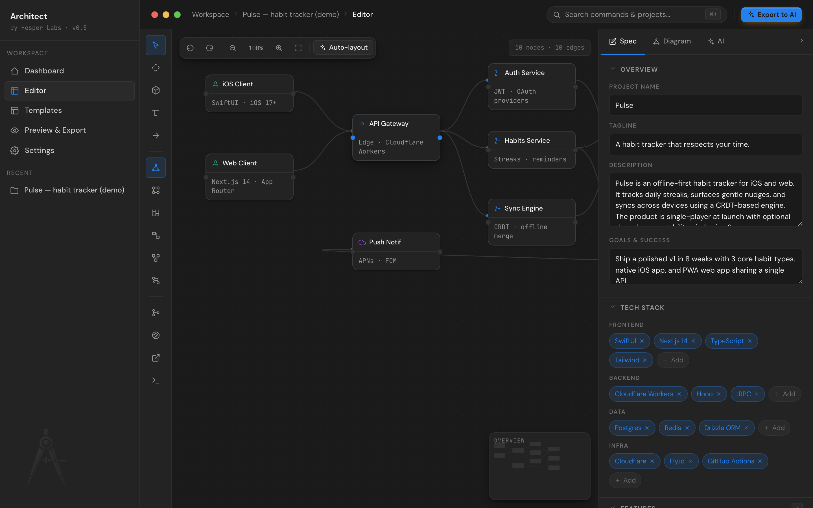

# Architecture canvas

The center pane of the editor. SVG + DOM, hand-rolled (no React Flow / Konva dependency).

## Tools (tool rail, left)

| Tool            | Shortcut         | What it does                                                                                                                                                       |
| --------------- | ---------------- | ------------------------------------------------------------------------------------------------------------------------------------------------------------------ |
| **Select**      | `V`              | Click to select a node, drag to move it, marquee-drag the background to box-select multiple                                                                        |
| **Pan**         | `H` (or `Space`) | Drag the background to scroll the canvas. Middle-click and Alt+drag also pan                                                                                       |
| **Add node**    | `N`              | Click the canvas to drop a typed node and immediately edit its label                                                                                               |
| **Sticky note** | `T`              | Click the canvas to drop a yellow sticky-note (no ports — pure annotation)                                                                                         |
| **Connect**     | `E`              | Click two nodes in succession to link them. Esc to cancel. Or just port-drag from a node's right edge to a target's left edge — that works without switching tools |

A floating hint banner appears at the top of the canvas while these modal tools are active so you don't have to remember what comes next.

## Diagram types

Six types switch how the canvas renders and how it exports to Mermaid:

| Type           | Shape language                                       | Mermaid output                                                                 |
| -------------- | ---------------------------------------------------- | ------------------------------------------------------------------------------ |
| **System**     | Boxes with rounded corners, ports for connections    | `graph LR` with shape per node type (`[(db)]`, `[/queue/]`, `((cloud))`, etc.) |
| **User flow**  | Same shapes, vertical layout                         | `flowchart TD`                                                                 |
| **Sequence**   | Renders as a sequence diagram (lifelines + messages) | `sequenceDiagram` with participants and arrows                                 |
| **Data / ER**  | Boxes with field lists                               | `erDiagram` with relations                                                     |
| **Components** | Tree-like layout                                     | `graph TD`                                                                     |
| **State**      | Shapes with start/end markers                        | `stateDiagram-v2`                                                              |

Switch from the tool rail's diagram-type segment, or from the Spec panel's Diagram tab.

## Nodes

The 16 node types each carry a default icon + accent color:

| Type                        | Icon              | Use for                          |
| --------------------------- | ----------------- | -------------------------------- |
| `user`                      | person            | Human actor / client             |
| `api`                       | api               | API gateway / endpoint           |
| `fn`                        | function          | Service / function               |
| `db`                        | database cylinder | Database                         |
| `cloud`                     | cloud             | External / managed service       |
| `queue`                     | rect              | Queue / pub-sub                  |
| `box`                       | box               | Generic component                |
| `entity`                    | er                | ER entity                        |
| `state`, `initial`, `final` | circle            | State machine states             |
| `actor`, `system`           | –                 | Sequence diagram participants    |
| `component`                 | tree              | Component tree                   |
| `note`                      | text              | Free-form sticky note (no ports) |

Pick / change a node's type from the **Type, shape & color** picker in the spec panel's Diagram tab — it shows all types with their accent color so you can see the result before clicking.

### Editing node properties

Click a node, the spec panel auto-opens to the **Diagram** tab. Edit:

- **Label** — the visible name
- **Subtitle / detail** — the second line under the label
- **Type, shape & color** — pick from the 16 types
- **Position** — exact x/y coordinates (for pixel-perfect alignment)

Double-click a node to inline-edit its label without opening the panel.

### Selection actions

| Shortcut                   | Action                                      |
| -------------------------- | ------------------------------------------- |
| Click                      | Select one node                             |
| Shift / Cmd / Ctrl + click | Toggle node in multi-selection              |
| Drag background            | Marquee-select                              |
| `⌘A` (or `Ctrl A`)         | Select all                                  |
| `⌘D` (or `Ctrl D`)         | Duplicate selection (offset +24,+24)        |
| `⌘C` (or `Ctrl C`)         | Copy selection (nodes + edges between them) |
| `⌘V` (or `Ctrl V`)         | Paste at offset +32,+32                     |
| `⌫` / `Delete`             | Delete selection                            |
| `Esc`                      | Clear selection / cancel current tool       |

## Edges

Connect two nodes by either:

- Switching to the **Connect (E)** tool and clicking source then target
- Or dragging from a node's right port (small dot on the right edge) to the target's left port

Edges have a label slot — click an edge to select it, then edit the label inline (or via the spec panel — coming).

Click an edge then `⌫` to delete it. Edges connecting deleted nodes are auto-removed.

## Auto-layout

The canvas toolbar (top-left) has an **Auto-layout** button that runs a BFS-based hierarchical layout: source nodes (no incoming edges) go in column 0, their children go in column 1, etc. Within each column, nodes stack vertically.

Use it after adding many nodes manually to clean up the visual.

## Mini-map

Bottom-right of the canvas — a thumbnail overview that highlights the current selection. Read-only (no clicking to navigate yet).

## Sticky notes

Sticky notes (`T` tool) are intentionally different from regular nodes:

- **Yellow paper** color, soft shadow, slight rotation for character
- **No ports** — they don't connect to anything
- **No type** in the picker — they're always `type: "note"`
- **Decorative** — they don't appear in the Mermaid export, only in JSON / XML for archival

Use them for design notes, reminders, open questions inside the diagram.

## Performance

The canvas handles a few hundred nodes without performance issues. If you're authoring a spec that needs more, consider splitting into sub-diagrams (one per service, or one per layer) and connecting them in the docs.

## See also

- [Spec editor](spec-editor.md) — the form on the right
- [Keyboard shortcuts](keyboard-shortcuts.md) — full reference
