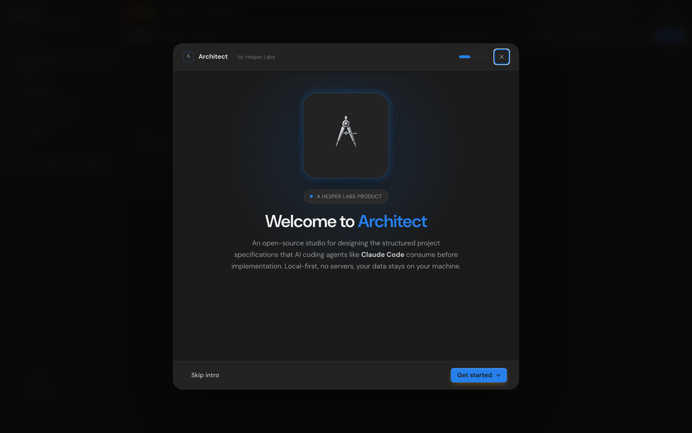
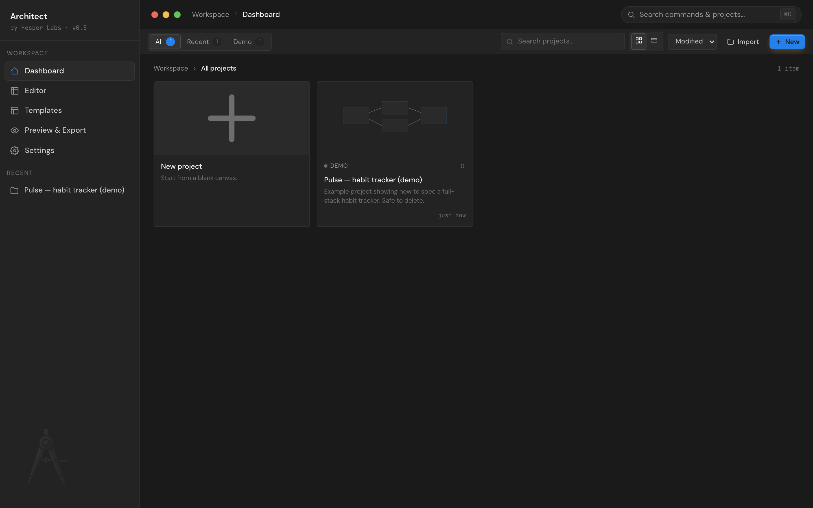
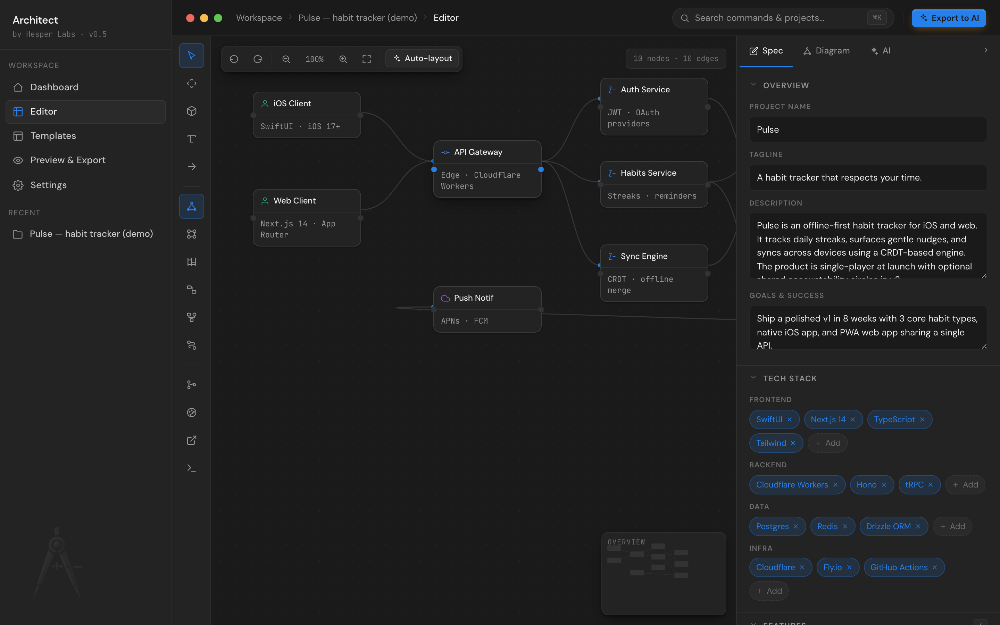

# Getting started

Architect runs locally in your browser. There's nothing to sign up for, no team to join, no key required to install.

## Install

```bash
git clone https://github.com/Hesper-Labs/architect.git
cd architect
npm install
npm run dev
```

Vite prints a URL (typically `http://localhost:5173`). Open it.

## First run — the welcome wizard



The first time you load Architect, a four-step wizard appears:

1. **Welcome** — what Architect is, by Hesper Labs.
2. **Features** — a quick tour of the four pillars: spec editor, canvas, AI co-architect, export.
3. **BYOK Claude** — paste an Anthropic API key (optional). You can skip this and add it later in Settings, or use the [claude.ai / Claude Code paths](byok-claude.md) instead.
4. **Ready** — kicks you into the [New project wizard](wizards.md#new-project-wizard).

The wizard shows once. After that it's gone forever, even after a reload. (Internally: `settings.hasSeenWelcome` is `true` in localStorage.)

## Your first project

Once the wizard finishes, you land on the **dashboard** with a Pulse demo project pre-loaded.



Click the demo card to open it in the **editor**, or hit **+ New** to launch the [New project wizard](wizards.md#new-project-wizard) and start fresh. The Pulse demo is safe to delete from its `⋯` menu once you don't need it.

## The editor



The editor has three columns:

- **Tool rail (left)** — diagram tools (Select / Pan / Add node / Sticky note / Connect), diagram type switcher, modal launchers (History / Design / Handoff / Chat).
- **Canvas (center)** — drag-and-drop nodes, click-to-connect edges, six diagram types.
- **Spec panel (right)** — three tabs: **Spec** for the structured form, **Diagram** for node properties, **AI** for inline Claude review.

Click a node, the spec panel auto-opens to the **Diagram** tab so you can rename, recolor, and reposition without hunting for the tab. Press the chevron at the panel's top-right to collapse it; a vertical "Spec" handle pinned to the right edge brings it back.

## Save and export

Architect auto-saves your edits to `localStorage` 600 ms after each change — there's no save button to forget. Hit `⌘S` (or `Ctrl S`) for a manual flush + a "Saved" toast.

Export when you're ready to hand off to an AI agent:

- `⌘E` opens the [Export modal](spec-editor.md#export)
- Pick a format (Markdown for Claude Code, JSON, XML, Mermaid, ASCII)
- One-click handoff to Claude.ai, Claude Code CLI, or GitHub PR

## Where to next

- [Spec editor](spec-editor.md) — what each section is for
- [Architecture canvas](canvas.md) — every tool explained
- [BYOK Claude](byok-claude.md) — three ways to wire up AI features
- [Keyboard shortcuts](keyboard-shortcuts.md) — for the keyboard people
