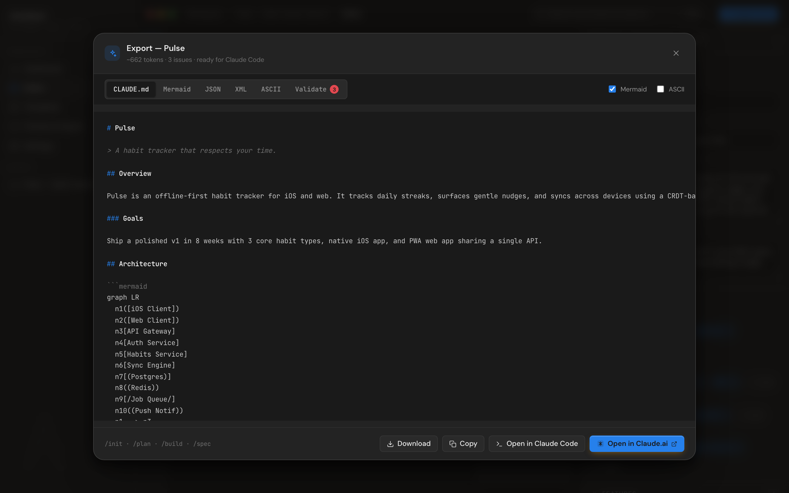
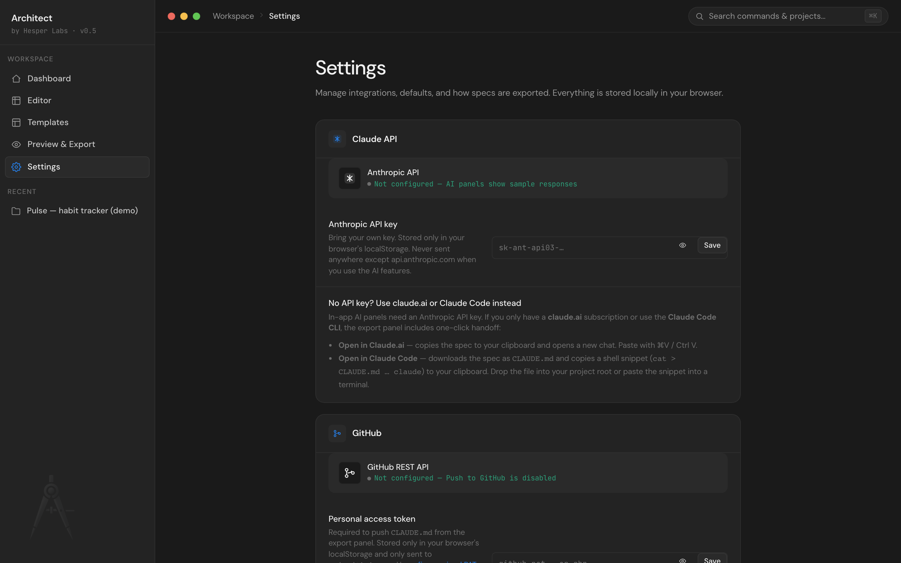

# GitHub push

Architect can push your spec as `CLAUDE.md` directly to a GitHub repo, on a feature branch, optionally with a pull request opened against the default branch. Real REST calls to `api.github.com` from your browser — no proxy server, no third party.



## Setup

You need a GitHub personal access token (PAT). Two flavors, both work:

### Option A — Fine-grained PAT (recommended)

1. Visit [github.com/settings/tokens?type=beta](https://github.com/settings/tokens?type=beta)
2. **Generate new token** (fine-grained)
3. Set the repository scope to _only the repos_ you want to push to
4. Set permissions:
   - **Contents** → Read and write
   - **Pull requests** → Read and write (if you want PRs created)
5. Copy the token (`github_pat_…`)

Pros: scoped to specific repos, expires automatically, revokable per-token.

### Option B — Classic PAT

1. Visit [github.com/settings/tokens](https://github.com/settings/tokens)
2. **Generate new token (classic)**
3. Tick the `repo` scope (this is one switch covering everything you need)
4. Copy the token (`ghp_…`)

Pros: simpler. Cons: full repo access, no per-repo scoping.

### Saving the token in Architect



Settings → GitHub → paste the token → **Save**. Status pill flips to "Token saved — Push to GitHub is enabled".

The token is stored only in `localStorage` at `architect:github_pat`, sent only to `api.github.com` (CSP-restricted), and never appears in URLs or logs.

## Pushing

1. Open the Export modal (`⌘E` from the editor)
2. Click **Push to GitHub**
3. Fill in:
   - **Repository** — `owner/repo` format (e.g. `Hesper-Labs/your-project`)
   - **Branch** — default is `architect/<project-slug>-<date>`, edit if you like
   - **Commit message** — defaults to `docs: update CLAUDE.md from Architect spec`
   - **Open pull request after commit** — checkbox, defaults on
4. Click **Push to GitHub**

What happens (visible in the loading state):

```
Resolving default branch · creating <branch> · committing CLAUDE.md · opening PR
```

Internally:

1. `GET /repos/{owner}/{repo}` to find the default branch (`main` / `master` / whatever)
2. `GET /repos/{owner}/{repo}/git/ref/heads/{default}` for the SHA tip
3. `POST /repos/{owner}/{repo}/git/refs` to create the new branch from that SHA (idempotent — 422 "ref exists" is silently OK)
4. `GET /repos/{owner}/{repo}/contents/CLAUDE.md?ref={branch}` to find the file's existing SHA (or 404 if it's the first commit)
5. `PUT /repos/{owner}/{repo}/contents/CLAUDE.md` with base64-encoded content
6. (Optional) `POST /repos/{owner}/{repo}/pulls` to open the PR

On success you get clickable links to:

- The pull request (if opened)
- The CLAUDE.md file on the new branch
- The commit

## Iterating

Pushing again with the same branch name works — Architect picks up the existing file SHA and updates the file (rather than failing with a "file already exists" error). Same branch + new commit message = clean diff in the PR.

If you want to push to a different branch, just change the **Branch** field. If you want a fresh branch each push, the default name includes today's date so back-to-back pushes naturally separate.

## What gets committed

The `CLAUDE.md` content is whatever's in your **Export modal → CLAUDE.md tab** at the moment you press Push. That includes:

- Full spec (overview, stack, features, models, endpoints, stories, constraints, conventions, deploy)
- Mermaid architecture diagram (if **Include Mermaid** is on, default)
- ASCII fallback (if **Include ASCII** is on, default off)

The Handoff package's accepted ADRs and high-severity risks aren't in the standard CLAUDE.md export yet — they live in the JSON and XML exports. Roadmap.

## Troubleshooting

| Error                                   | Likely cause                                                                       | Fix                                                                                                                                          |
| --------------------------------------- | ---------------------------------------------------------------------------------- | -------------------------------------------------------------------------------------------------------------------------------------------- |
| `Invalid GitHub token` (401)            | Expired, revoked, or wrong format                                                  | Generate a new PAT, paste it in Settings                                                                                                     |
| `GitHub denied access` (403)            | PAT doesn't have the right scopes for the repo                                     | Recheck Contents and Pull requests permissions on the fine-grained PAT, or that the classic PAT has `repo`                                   |
| `Not found` (404)                       | Repo name typo, or the PAT doesn't have access to that repo (fine-grained scoping) | Double-check `owner/repo`, and that the fine-grained PAT lists the repo                                                                      |
| `Network error reaching api.github.com` | Offline, blocked corporate proxy, or CSP misconfiguration                          | Check connectivity; verify CSP includes `api.github.com` in `connect-src` (it does by default)                                               |
| PR creation failed (file pushed though) | Branch protection, missing pull-request permission                                 | The file is committed; open the PR manually on GitHub. Add the `Pull requests: read+write` permission to your fine-grained PAT for next time |

## Why no GitHub OAuth (for now)?

OAuth would mean a server somewhere holding the GitHub app credentials. Architect is local-first and refuses to add a backend for a feature this small. PAT-based works in any environment, gives the user full transparency about scope, and doesn't lock anyone into a specific deployment.

If you fork Architect for a hosted deployment, swapping in OAuth is straightforward — `src/lib/github.js` already handles `gho_` (OAuth) and `ghs_` (App installation) tokens.

## See also

- [Settings](spec-editor.md) — where the PAT lives
- [BYOK Claude](byok-claude.md) — same BYOK pattern for Anthropic
- [SECURITY.md](../SECURITY.md) — threat model
