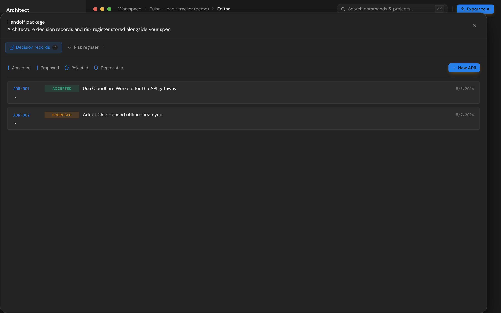

# Handoff package

Architecture decisions and risks live in their own modal but are stored alongside your spec. Everything here ships with the project export.

Open from the editor tool rail (right side) or via the command palette (`⌘K` → "handoff").

## Why these and not just notes?

Engineering teams already write ADRs and risk registers. Two reasons to keep them in Architect:

1. They travel with the spec into AI handoff — the export's `## Decisions` section is exactly what an agent needs to avoid second-guessing your choices.
2. The validator surfaces gaps: P0-feature-heavy projects with no accepted ADRs flag "no architecture decisions recorded" so reviewers (and you, six weeks later) aren't left guessing.

## Architecture decision records (ADRs)

Click **+ New ADR** or expand an existing one to edit. Six fields:

- **Title** — one short sentence describing the decision (e.g. "Use Cloudflare Workers for the API gateway")
- **Status** — `proposed` / `accepted` / `rejected` / `deprecated`
- **Context** — what problem you're solving and what constraints apply
- **Decision** — what you decided to do
- **Consequences** — trade-offs (positives, negatives, follow-ups)
- **Alternatives considered** — what else you evaluated and why you rejected it
- **Deciders** — who approved this

Each ADR auto-gets an ID like `ADR-001`. Status maps to a colored chip in the list view.

### Writing good ADRs

- Title and context lock down the **why**. If you can't explain the why in one sentence, the ADR isn't ready.
- Consequences should be honest about negatives — pretending the decision is free is the most common ADR failure.
- Alternatives are not optional. "We didn't consider anything else" is itself a finding.

The validator flags "no accepted ADRs" once a project has 5+ features, because at that point you almost certainly made decisions worth recording.

## Risk register

Inline editable table. Each row:

| Field          | What                                                                            |
| -------------- | ------------------------------------------------------------------------------- |
| **ID**         | Auto-generated `R-01`, `R-02`, …                                                |
| **Risk**       | One-sentence description of what could go wrong                                 |
| **Lik**        | Likelihood, 1–5                                                                 |
| **Imp**        | Impact, 1–5                                                                     |
| **Sev**        | Severity = likelihood × impact, color-coded (≥ 15 high / ≥ 8 medium / else low) |
| **Owner**      | Who watches this risk                                                           |
| **Status**     | `mitigating` / `monitoring` / `accepted` / `closed`                             |
| **Mitigation** | What you're doing about it                                                      |

Add new risks with **+ New risk**, delete via the trash icon at the end of the row.

### Calibrating likelihood and impact

The 1–5 scale is intentionally rough — fine-grained probabilities are false precision for this kind of work.

| Score | Likelihood           | Impact                   |
| ----- | -------------------- | ------------------------ |
| 1     | Very unlikely        | Trivial / cosmetic       |
| 2     | Possible but unusual | Minor inconvenience      |
| 3     | About even odds      | Real loss / rework       |
| 4     | More likely than not | Major loss / launch slip |
| 5     | Near certain         | Project-killing          |

The validator flags a risk register with no high-severity items on a multi-feature project as "honest risk assessment usually surfaces at least one ≥15." If your register is all 6s and 8s on a 12-feature product, you're probably under-scoring.

## Where this data lives

Both lists are stored in `spec.handoff = { adrs: [], risks: [] }` and persisted with the rest of the project content. Exporting the project as JSON includes them; importing a `.architect.json` restores them.

The Markdown export (CLAUDE.md) includes accepted ADRs and high-severity risks under their own headings — what an AI agent reads when generating code.

## See also

- [Spec editor](spec-editor.md) — the spec the ADRs and risks are attached to
- [Validation rules](spec-editor.md#validation) — including ADR / risk coverage checks
- [Storage](storage.md) — where handoff data is stored on disk
