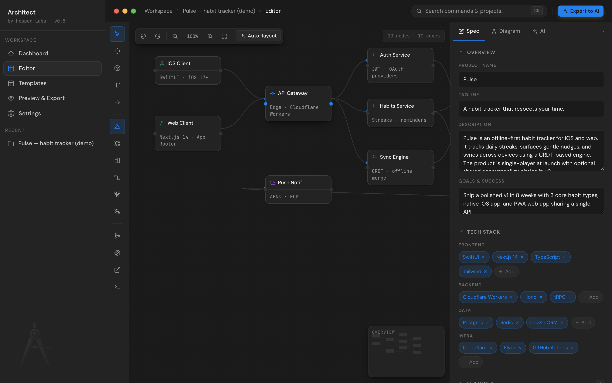
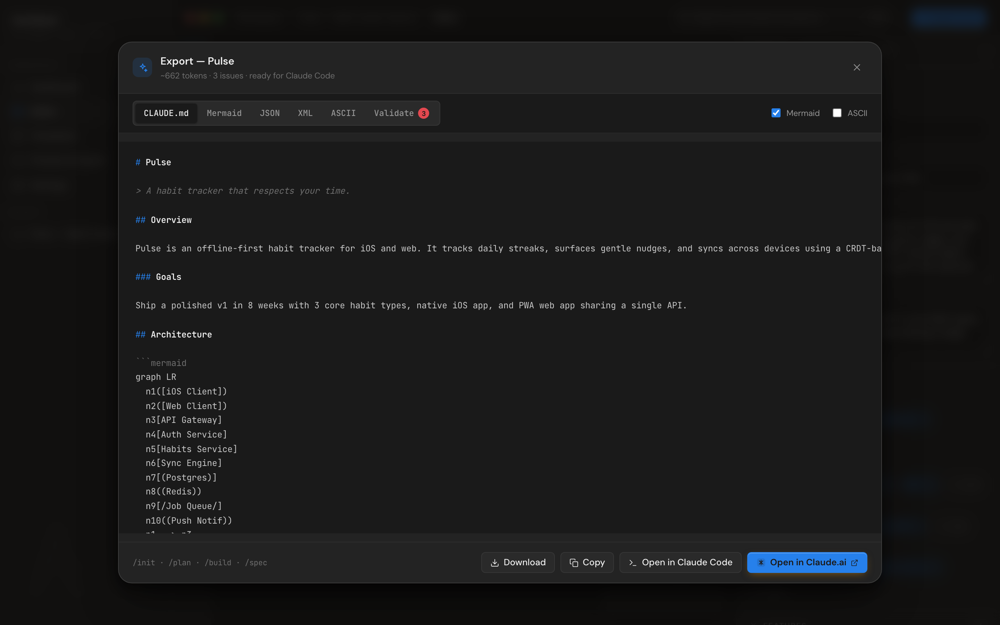

# Spec editor

The spec is what Architect actually exports. Everything else (canvas, handoff, AI chat) reads from or writes into this single tree of structured data.

The spec panel lives on the right side of the editor and has three tabs.



## Spec tab

The spec is grouped into nine collapsible sections. Each section maps directly to part of the exported `CLAUDE.md`. Fill in what you have — empty sections export as empty headings, so an AI agent never sees a blank where it expects content.

### Overview

| Field               | What an AI agent does with it                                                                                                  |
| ------------------- | ------------------------------------------------------------------------------------------------------------------------------ |
| **Project name**    | Used as the H1 in `CLAUDE.md`. First impression.                                                                               |
| **Tagline**         | One-sentence positioning. Set the agent's expectations of scope.                                                               |
| **Description**     | Two to three sentences explaining what the product is and why it exists. The validator flags descriptions under 60 characters. |
| **Goals & success** | Concrete success criteria. Helps the agent prioritize when constraints conflict.                                               |

### Tech stack

Four chip groups: **Frontend / Backend / Data / Infra**. Click a chip's `×` to remove, click **+ Add** to type a new entry. The validator flags endpoints defined without a backend stack.

### Features

Sortable list. Each feature has a title, a priority chip (P0 / P1 / P2), and a note. The validator warns if a P0 feature has no note (AI agents have less to work with).

P0 features should also appear in your user stories — the validator cross-checks this and flags any P0 feature whose key words don't show up in the stories array.

### Data models

Each model is a `name` plus a comma-separated `fields` string. Example:

```
Habit  ·  id, user_id, title, cadence, target, color, archived
```

The validator flags:

- Models with no endpoints (informational — might be internal)
- Models that mix `snake_case` and `camelCase` fields (warning — pick one convention)

### API endpoints

Method + path. The validator runs three checks:

- **Coverage** — endpoint paths should reference at least one model name
- **Versioning** — if some paths use `/v1/...` and others don't, flagged as inconsistent
- **Casing** — flags paths that mix kebab-case and camelCase

### User stories

Sortable list of "As a user, I can…" statements. Used as acceptance criteria in the export. The validator pairs them with P0 features (see Features above).

### Constraints & non-goals

Two chip groups: **Must-haves** (hard requirements like accessibility, performance budgets) and **Non-goals** (things you've explicitly chosen not to build).

Empty must-haves trigger an informational notice — agents fall back to defaults that may not match your intent.

### Conventions

Three free-form blocks: **Code style**, **Naming**, **Testing**. The validator flags an empty testing strategy.

### Deployment

Environments chip group + free-form notes. Goes into the export's `## Deployment` section.

## Diagram tab

When a node is selected on the canvas, the Diagram tab shows its properties (label, sub, type, position). Architect auto-switches to this tab on selection — no need to hunt for it.

The **Type, shape & color** picker shows all 16 node types with a color swatch + icon + label. Selecting a type changes the node's visual on the canvas (color, icon, ports for non-note types).

When no node is selected, the Diagram tab shows the diagram-type switcher and a few keyboard shortcuts.

## AI tab

Inline `<AIAssistant />` panel. Quick actions auto-prompt Claude with the current spec context:

- Audit my spec
- Suggest features
- Review the API
- List edge cases
- Tighten description
- Threat model

Or type a free-form question. Responses render in a chat thread.

If no Anthropic API key is configured, the panel falls back to canned sample responses — the UI never looks broken. Add your key in [Settings → Claude API](byok-claude.md) for live responses.

## Export

Hit `⌘E` (or click **Export to AI** in the topbar) to open the export modal.



Six tabs:

- **CLAUDE.md** — Markdown matching the [CLAUDE.md format](https://docs.anthropic.com/claude-code) used by Claude Code
- **Mermaid** — pure Mermaid syntax for the active diagram type
- **JSON** — machine-readable spec (great for piping into another tool)
- **XML** — for agents that prefer it over JSON
- **ASCII** — text-fallback diagram for environments without a Mermaid renderer
- **Validate** — the [validation engine](#validation) score and issue list

Five output buttons:

- **Download** — saves the active tab's content as `<project-slug>.md|json|xml|mmd|txt`
- **Copy** — clipboard
- **Open in Claude Code** — downloads `CLAUDE.md` and copies a shell snippet to start a Claude Code session
- **Open in Claude.ai** — copies the spec and opens a fresh `claude.ai/new` chat
- **Push to GitHub** — opens the [GitHub push flow](github-push.md)

## Validation

The validate tab runs 15 checks across the spec and canvas, scores out of 100, and lists every issue with a concrete fix.

<details>
<summary>The 15 checks</summary>

| ID  | Section     | Level        | What it checks                                                         |
| --- | ----------- | ------------ | ---------------------------------------------------------------------- |
| M1  | Overview    | error / warn | Description present and non-trivial (≥ 60 chars)                       |
| M2  | Features    | error        | At least one feature defined                                           |
| M2b | Features    | warn         | P0 features have a note                                                |
| M3  | API         | warn         | Endpoint paths reference data models                                   |
| M4  | Models      | info         | Each non-User model has at least one endpoint                          |
| M5  | Diagram     | warn         | No disconnected nodes                                                  |
| M6  | Stack       | error        | Backend stack present if endpoints exist                               |
| M7  | Stories     | info         | At least one user story                                                |
| M8  | Constraints | info         | At least one must-have                                                 |
| M9  | Conventions | info         | Testing strategy specified                                             |
| M10 | API         | warn         | Endpoint versioning consistent (all `/v1/...` or none)                 |
| M11 | API         | warn         | Path casing consistent (kebab-case OR camelCase, not both)             |
| M12 | Models      | warn         | Each model uses one casing convention                                  |
| M13 | Stories     | info         | P0 features appear in user stories                                     |
| M14 | Handoff     | info         | Multi-feature projects (5+) have at least one accepted ADR             |
| M15 | Handoff     | info         | Multi-feature projects with risks have at least one high-severity item |

Score: `100 − errors×15 − warns×5 − infos×1`, clamped at 0. The validator never flags style preferences (e.g., your variable naming) — only inconsistencies and missing context that an AI agent would stumble on.

</details>

## See also

- [Architecture canvas](canvas.md) — diagram authoring
- [Handoff package](handoff.md) — ADR + Risk register that ships alongside the spec
- [Wizards](wizards.md) — how a new project gets seeded
