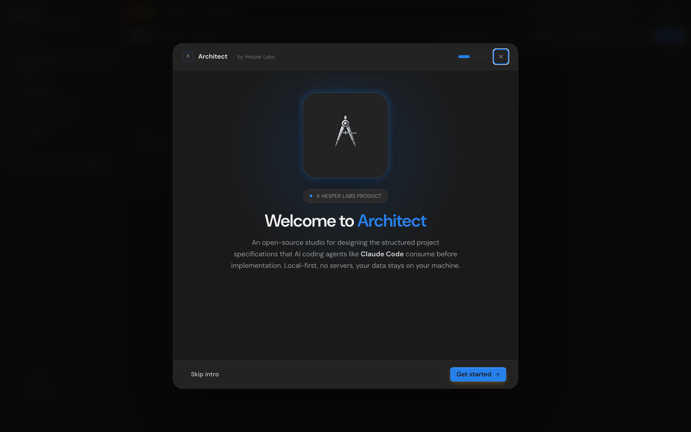
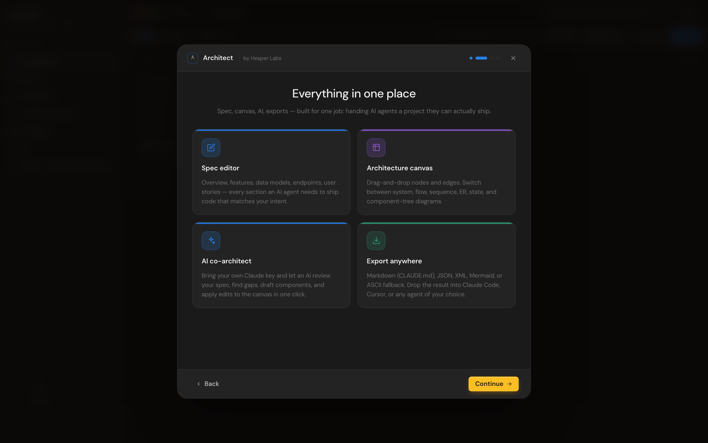
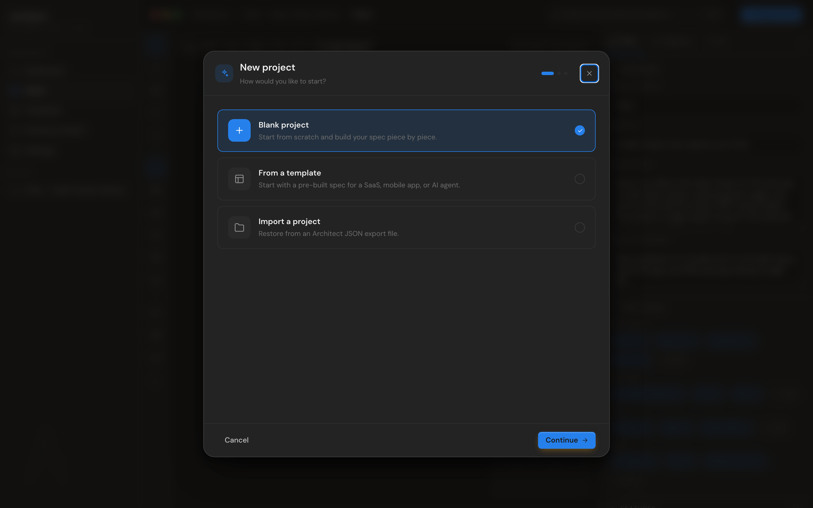

# Wizards

Architect has two wizards: a **welcome wizard** that runs once for new users, and a **new-project wizard** that runs every time you create a project.

## Welcome wizard




Four steps:

1. **Hero** — logo, "Welcome to Architect by Hesper Labs", short pitch
2. **Features** — four feature cards (spec editor, canvas, AI co-architect, export)
3. **BYOK** — paste an Anthropic API key now, or skip and add it in Settings later. Also explains the [claude.ai / Claude Code paths](byok-claude.md) for users without an API key
4. **Ready** — kicks you into the new-project wizard

Shows once. After dismissal (any of: Skip intro, complete, or close button), `settings.hasSeenWelcome` is set in localStorage and the wizard never appears again. Skipping doesn't lock you out of anything — every welcome content is also in the [docs](README.md).

If you need to re-trigger the wizard for testing, paste this in DevTools:

```js
const s = JSON.parse(localStorage.getItem("architect:settings") || "{}");
s.hasSeenWelcome = false;
localStorage.setItem("architect:settings", JSON.stringify(s));
location.reload();
```

## New-project wizard



Three flows depending on what you pick at step 1:

### Blank project

1. **How to start** → Blank
2. **Architecture preset** — six options (descriptions in the wizard)
3. **Details** — project name + tagline

Architecture presets seed the canvas with a starter set of nodes + edges:

| Preset                   | Nodes                                                                                             |
| ------------------------ | ------------------------------------------------------------------------------------------------- |
| **Blank canvas**         | Empty — add your own                                                                              |
| **Web app — monolithic** | Web client → App server → Database (3 nodes, 2 edges)                                             |
| **Microservices**        | Client → API Gateway → 3 services → Postgres + Redis (7 nodes, 7 edges)                           |
| **Serverless / edge**    | Browser → CDN → Edge functions + Background jobs → Managed DB + Object storage (6 nodes, 5 edges) |
| **Mobile-first**         | iOS + Android → API → Database + Push service (5 nodes, 4 edges)                                  |
| **AI agent app**         | Web client → Chat API → Agent loop → LLM provider + RAG retrieval → Vector DB (6 nodes, 5 edges)  |

### From template

1. **How to start** → From template
2. **Template gallery** — three bundled spec templates with full content (overview, stack, features, models, endpoints, stories, conventions)
3. **Details** — name + tagline (auto-suggested from the template, override as needed)

Bundled templates:

- **Acme SaaS** — Next.js + Postgres + Stripe billing
- **Tribe** — React Native realtime social app
- **Lattice** — AI agent with tool calling and RAG

The template fills in the spec; you can edit anything afterward.

### Import a project

1. **How to start** → Import
2. **File picker** — drop a `.architect.json` file you exported earlier

Imported projects get a fresh ID (so importing the same file twice creates two separate projects, not a conflict).

## Programmatic equivalents

You can skip the wizard from anywhere:

- `⌘K` → "Create new project" — opens the new-project wizard
- Dashboard → **+ New** — same
- Templates view → **Use** on any template — opens the wizard pre-filled with that template

## See also

- [Getting started](getting-started.md) — first-run flow
- [Spec editor](spec-editor.md) — what to do once the wizard finishes
